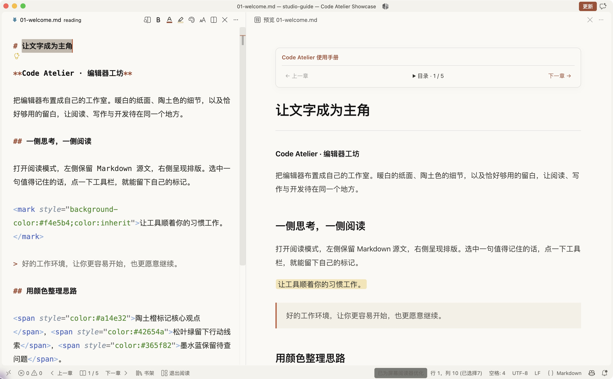
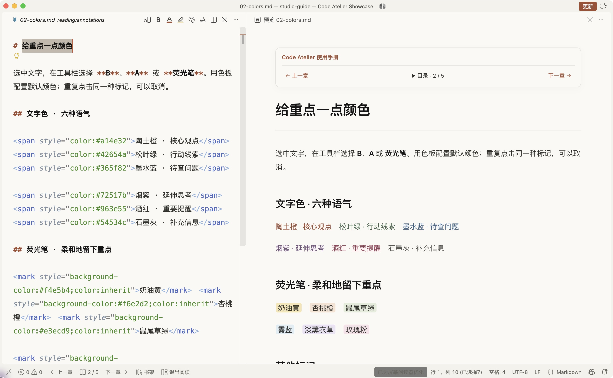
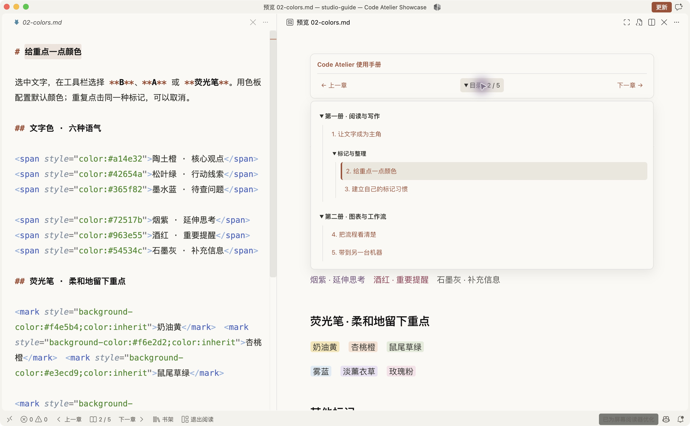
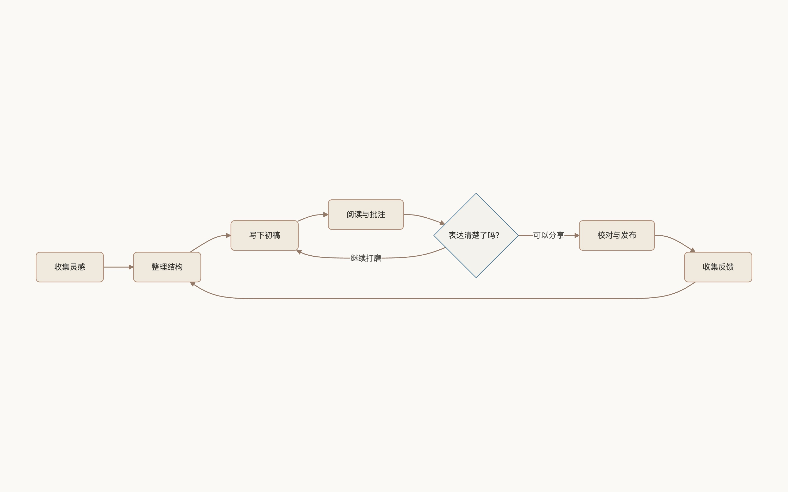
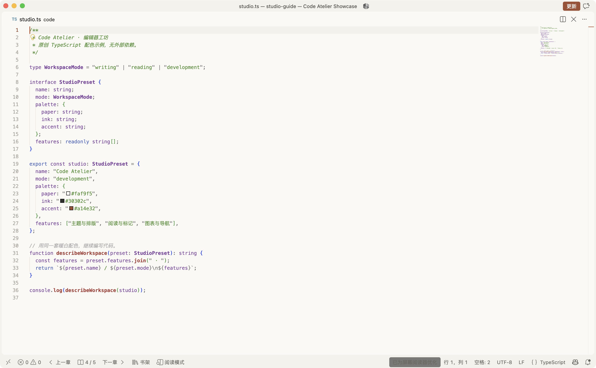

# Code Atelier

**Make VS Code your own studio.**

An evolving toolkit for the appearance and everyday experience of VS Code: warm themes, thoughtful Markdown annotation, book navigation, diagram viewing, and optional development presets. Reading is one module, not the limit of the project.

[简体中文](README.md) · [Releases](https://github.com/infra403/code-atelier/releases) · [Installation](docs/installation.md) · [Roadmap](ROADMAP.md) · [Contributing](CONTRIBUTING.md)



All screenshots show the actual extension using the original [sample book](examples/studio-guide/README.md) included in this repository. The current interface is primarily Chinese.

## Available today

- **Appearance:** warm paper, charcoal text, terracotta accents, coordinated preview styles, and cursor/hover preferences.
- **Writing:** bold, italic, underline, strikethrough, six text colors, and six highlight colors. Configure a color once, then apply it with one click. Toolbar icons show the configured color.
- **Reading:** one command opens source on the left and preview on the right. Search your bookshelf, navigate nested volumes, and resume the last chapter.
- **Diagrams:** zoom and pan Mermaid SVGs, or open a local browser viewer for true fullscreen. Diagram snapshots stay on your machine.
- **Optional development presets:** Python, frontend, Go, and the official Codex extension, with macOS/Windows installers and settings backup/restore.

| Annotations | Nested navigation |
| --- | --- |
|  |  |



<details>
<summary>The same warm theme for code</summary>



</details>

## Start with the extension

1. Install the current stable VS Code.
2. Download `paper-writing-1.3.0.vsix` from the [latest release](https://github.com/infra403/code-atelier/releases/latest).
3. Run **Extensions: Install from VSIX…** and select the file.
4. Select the **纸页 · Claude** color theme and open a trusted Markdown folder.
5. Run **纸页：进入／退出阅读模式** to enter reading mode. Select text in the source editor to use the formatting buttons.

The extension is distributed as a VSIX; it is not yet listed on the Marketplace. The legacy extension ID (`local.paper-writing`), theme name, and `paperWriting.*` settings remain compatible with previous versions. Existing colors are unchanged.

Open `examples/studio-guide` to try the sample book. Editor spacing and cursor preferences shown in screenshots can be copied from [writing settings](docs/installation.md#仅应用截图中的写作设置); the VSIX supplies preview styles, commands and navigation independently of the development installers.

## Optional full setup

```sh
git clone https://github.com/infra403/code-atelier.git
cd code-atelier
```

On macOS run `bash install-macos.sh`; on Windows use `.\install-windows.ps1` in PowerShell. These scripts install/configure development tooling as well as extensions. Read the [installation guide](docs/installation.md) for prerequisites, dry runs, profiles, updates and recovery. Each machine uses its own library paths and Codex sign-in.

## Maintenance and scope

Code Atelier is actively maintained. [The roadmap](ROADMAP.md) separates future directions from shipped features. Contributions to themes, interface details, layouts, features and documentation are welcome; there is no fixed release schedule or response-time commitment.

Automated checks run on macOS and Windows. Linux installation has not been fully validated. Reading supports local Markdown, not PDF/EPUB. Color/highlight markup uses inline HTML and may be filtered by other renderers. Preview-side editing and standalone viewing of ordinary raster images are not currently supported. Large libraries have bounded scanning limits.

## License

[MIT](LICENSE). The syntax theme is based on Microsoft's Quiet Light and retains its copyright notice. Third-party extensions are referenced by ID and retain their own licenses.

An independent community project, not affiliated with Microsoft, Anthropic or OpenAI. The legacy Claude theme name describes visual inspiration; Codex is an optional official third-party extension.
