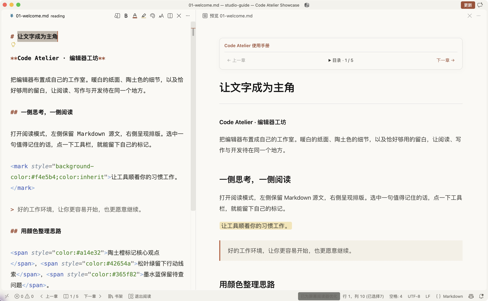
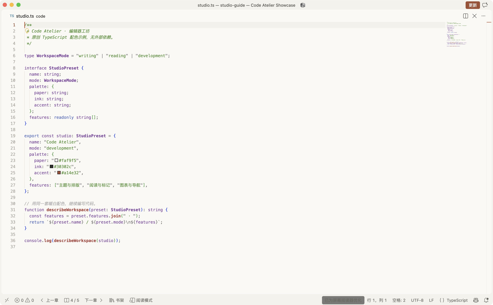
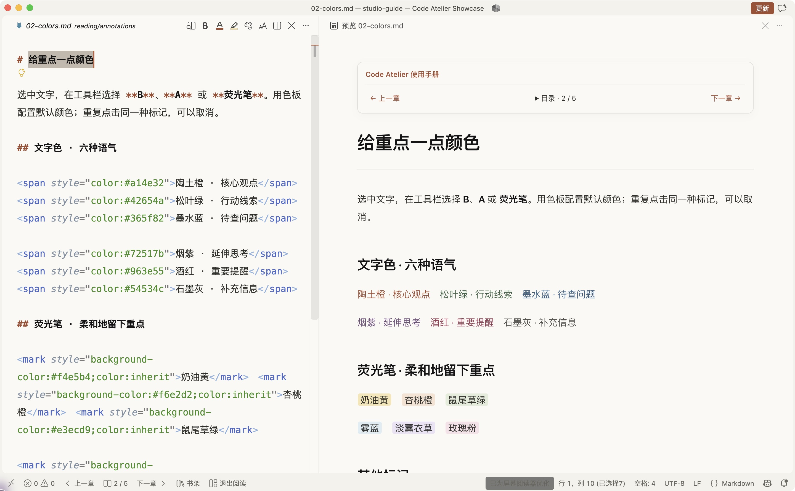
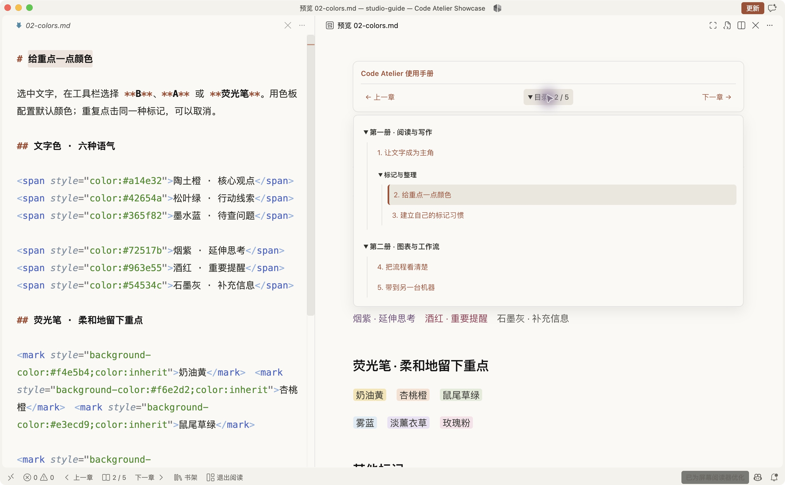
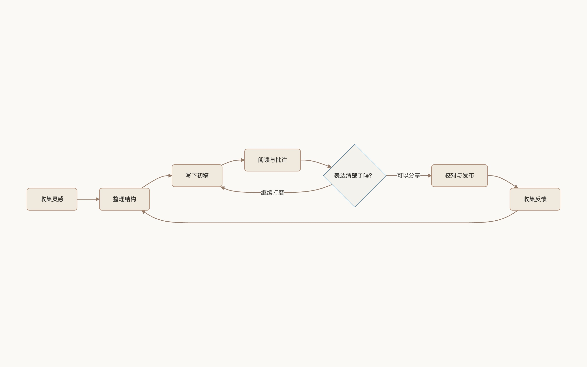

# Code Atelier · 编辑器工坊

**把 VS Code 布置成自己的工作室。**

从暖白纸面和细腻的标记，到顺手的书架导航与开发配置。Code Atelier 持续探索 VS Code 的外观与工作体验，让阅读、写作和开发都有适合自己的空间。

[](https://github.com/infra403/code-atelier/actions/workflows/check.yml)
[](LICENSE)
[](https://github.com/infra403/code-atelier/releases)

简体中文 · [English](README.en.md) · [安装指南](docs/installation.md) · [更新记录](CHANGELOG.md) · [路线图](ROADMAP.md)



> 实际运行截图，内容来自仓库自带的[原创示例书](examples/studio-guide/README.md)。已实现模块见下文；未来方向单独记录在路线图中。

## 现在可以做什么

| 模块 | 已有体验 |
| --- | --- |
| 外观 | 暖白底色、陶土色强调、中文排版、光标与悬停细节；编辑器与预览保持一致 |
| 阅读与写作 | 一键双栏：左侧选词标记、右侧阅读；六种文字色、六种荧光笔色，以及加粗、斜体、下划线、删除线 |
| 书架与导航 | 书库搜索、跨分册翻章、默认展开的多级目录、继续上次阅读 |
| 图表 | Mermaid 矢量图放大、拖动、缩放，以及在本机浏览器中单独全屏 |
| 开发配置（可选） | Python / 前端 / Go 编辑器配置与 OpenAI Codex 扩展；Mac / Windows 安装与备份恢复 |

### 同一间工作室，也适合写代码



外观主题覆盖整个编辑器；语言工具、格式化器和 Codex 可以按工作需要另外配置。

### 标记一次，继续思考



在**左侧源文**选中文字，点工具栏的 **B / A / 荧光笔**。配色只需设置一次；按钮的色条和提示会显示当前颜色，再点同种标记即可取消。右侧是实时预览，尚不支持直接在预览里划词编辑。

### 让长书的目录保持清楚



运行 **纸页：添加书库**，选择包含多本书的文件夹。目录优先遵循 `SUMMARY.md`、`CONTENTS.md` 或 `README.md` 的本地链接顺序，递归展开分册；无目录时按文件名自然排序。导航显示在预览中，不写进正文。

### 给复杂图表整个屏幕



点击图表旁的 **图片单独全屏 ↗**，再点独立页面里的全屏按钮。滚轮缩放，左键拖动；全屏时工具栏自动隐藏，移动鼠标重新显示。图表仅在本机处理，不上传外部服务。当前入口针对预览里的 Mermaid SVG，普通位图尚不在此模块支持范围内。

## 五分钟开始

### 只想体验外观、阅读与标记

1. 安装当前稳定版 [VS Code](https://code.visualstudio.com/)。
2. 在 [Releases](https://github.com/infra403/code-atelier/releases/latest) 下载 `paper-writing-1.3.0.vsix`。
3. VS Code 扩展页 **… → 从 VSIX 安装**，选择下载的文件。
4. 选择主题 **纸页 · Claude**，打开一个可信的 Markdown 文件夹。
5. 命令面板运行 **纸页：进入／退出阅读模式**。

扩展目前通过 VSIX 分发，尚未发布到 Marketplace。主题名称与 `paperWriting.*` 设置键保留旧名，便于现有用户直接升级；暖白配色不变。可打开 `examples/studio-guide` 文件夹试用完整示例书。

只安装 VSIX 即可使用预览样式、标记和导航。截图中的编辑器字号、行距与光标偏好来自[写作设置](docs/installation.md#仅应用截图中的写作设置)，可以单独应用，不需要安装语言工具链。

### 同时配置 Python、前端、Go 与 Codex

```sh
git clone https://github.com/infra403/code-atelier.git
cd code-atelier
```

macOS 运行 `bash install-macos.sh`；Windows PowerShell 运行 `.\install-windows.ps1`。这条路径会配置开发工具及扩展，请先阅读[完整安装、预览与恢复步骤](docs/installation.md)。每台机器分别添加书库并登录自己的 Codex 账户。

## 持续维护

这是一个持续维护的开源项目，阅读只是其中一个模块。后续会围绕主题、界面细节、工作区布局和不同工作场景继续改进。具体方向见[路线图](ROADMAP.md)，已发布变化见[更新记录](CHANGELOG.md)。

欢迎提交 [Bug 与建议](https://github.com/infra403/code-atelier/issues) 或贡献代码、主题和文档。开发与验证步骤见 [CONTRIBUTING.md](CONTRIBUTING.md)。不承诺固定发布频率或问题响应时间。

## 支持范围

- macOS 与 Windows 有自动检查；Linux 暂无完整安装流程与验收。
- 阅读模块针对本地 Markdown；PDF、EPUB 与压缩包需要其他阅读器。
- 颜色、高亮和下划线使用内联 HTML；GitHub 等平台可能过滤样式。加粗与斜体等遵循 Markdown 解析规则。
- 目录扫描有深度、文件数与章节数上限；非标准目录可能需要整理链接。
- 安装器合并用户设置并备份，保留无关选项；主题和本方案管理的偏好会应用。第三方扩展与运行时分别遵循其许可证和服务条款。

## 许可证与鸣谢

[MIT](LICENSE)。暖白主题的语法配色基于 Microsoft 的 Quiet Light，保留其版权声明；其余界面、标记、导航、安装脚本及原创示例随仓库提供。

Code Atelier 是独立社区项目，与 Microsoft、Anthropic 或 OpenAI 无隶属关系。旧主题名中的 Claude 表示视觉灵感；Codex 是可选的官方第三方扩展。
