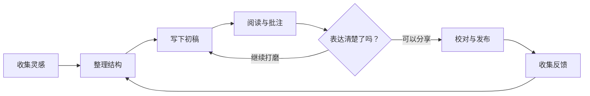

# 把流程看清楚

关系复杂时，让图表单独占据屏幕。点击图表旁的 **图片单独全屏 ↗**，再在独立页面中点击全屏按钮。

## 放大之后，保持上下文

滚轮缩放，按住左键拖动。点击 **全图** 查看完整关系，点击 **清晰字号** 回到适合阅读文字的尺寸。

全屏时工具栏会自动隐藏；移动鼠标就会出现。退出后，原来的双栏阅读位置仍在。

> 这是示例工作流。图表保留为 Mermaid 文本，随时可以继续修改。
