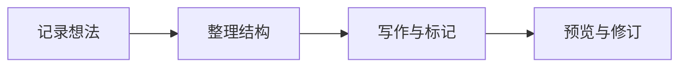

# 在纸页上写作

暖白背景、清晰的层次和一点陶土色。保持注意力，让文字成为页面的中心。

## 文字与标记

**这是加粗文字。** 这是 *斜体*、~~删除线~~ 和 <u>下划线</u>。

<span style="color:#a14e32">陶土色强调</span>，<span style="color:#42654a">松叶绿</span>，<span style="color:#365f82">墨水蓝</span>。

<mark style="background-color:#f4e5b4;color:inherit">奶油黄色的重点</mark>，<mark style="background-color:#f6e2e8;color:inherit">柔和的玫瑰粉</mark>。

> 在左侧选中文字，再点击工具栏的 B、A 或荧光笔。通过色板设置一次，之后每次点击直接应用。

## 图表



## 开发

```python
def greet(name: str) -> str:
    return f"Hello, {name}!"
```

| 场景 | 工具 |
| --- | --- |
| Python | Pylance + Ruff |
| 前端 | TypeScript + ESLint + Prettier |
| Go | gopls + Delve |
| AI 协作 | Codex |
